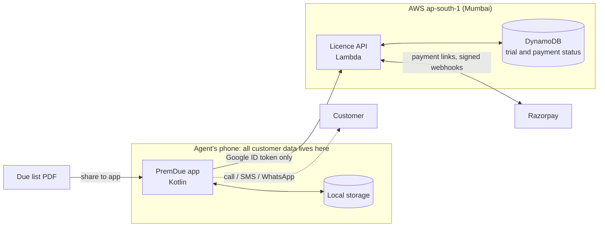
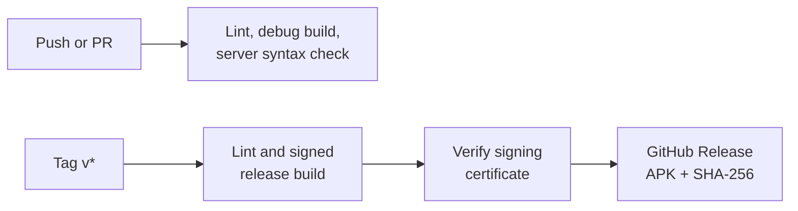

<div align="center">

# PremDue

### The renewal desk for LIC agents, in their pocket.

**Turn the monthly premium due list PDF into a prioritised daily worklist, and stop policies from lapsing.**

[](https://github.com/aryanipb/premdue/actions/workflows/ci.yml)
[](https://github.com/aryanipb/premdue/actions/workflows/release.yml)
[](https://github.com/aryanipb/premdue/releases/latest)


</div>

---

## The problem

An LIC agent's income depends on renewals, and renewals depend on chasing people. Every month the agent gets a due list as a PDF: a dense table of policy numbers, names, plans and premium modes. It says what is due, but not who to call first, whose grace period is running out, or which policy is about to lapse. Every missed follow-up can cost the customer their cover and the agent their commission.

## The solution

PremDue reads that PDF and turns it into a worklist. The agent shares the file to the app and immediately sees who needs attention today, then reaches each customer in one tap.

| | |
|---|---|
| 📄 **Instant PDF import** | Parses the official due list on the device, and checks the rows against the printed grand totals so a bad parse is refused, not silently wrong. |
| 🔴 **Lapse-risk triage** | Groups policies into lapse risk, new, maturing and regular, using LIC grace rules: 15 days for monthly premiums, 30 for the rest. |
| 💬 **One-tap follow-up** | Call, SMS or WhatsApp with the number and message filled in, then record the outcome on return. |
| 🔔 **Daily 9 AM summary** | A notification with the day's work, which recovers after a reboot or clock change. |
| 📊 **Insights** | Collections this month, lapse risk by months behind, dues by week, policy mix, biggest premiums and month-to-month trends. |
| 🧮 **Sales tools** | Policy return (IRR), human life value, retirement, child goal, inflation, growth, loan EMI and loan + SIP planners. |
| 🖨️ **Plan presentations** | Turn a plan illustration into a branded PDF and share it with a customer. |
| 🔒 **Private by design** | Customer data stays on the phone. Backups go only to places the agent controls. |

## Business model

**₹299 once, all inclusive, after a 7-day free trial.** There is no subscription. Trials run on server time, so reinstalling cannot reset them.

## Architecture

The core decision: the server never sees customer data. It only knows who has a licence.



### Engineering highlights

- **Small on purpose.** About 3,000 lines across the Android app, licence server and web pages, with no UI framework dependency.
- **Verified parsing.** Row totals must reconcile with the document's own grand totals before a list is accepted.
- **Dependency-free token checks.** The server verifies Google RS256 ID tokens itself, using only the Python standard library plus boto3.
- **Reliable payments.** Razorpay webhooks are HMAC-verified, and the server also re-checks Razorpay directly, so a missed webhook never loses a purchase.
- **Tamper-resistant trials.** Trial start is written once on the server with `if_not_exists`.
- **Privacy built in.** Data minimisation is designed around India's DPDP Act, 2023: see the [privacy policy](web/privacy.html).

## CI/CD



Every release is built by GitHub Actions from a tagged commit. The pipeline stops if the tag does not match the app version, or if the APK is not signed with the production certificate.

## Install

Download the latest APK from [**Releases**](https://github.com/aryanipb/premdue/releases/latest). It requires Android 8.0 or newer, and Android will ask you to allow installs from your browser.

## Build from source

Requires JDK 17 and the Android SDK (API 35).

```bash
./gradlew lintDebug assembleDebug
```

A fresh clone builds a debug APK without signing keys. Google sign-in needs the production signing certificate, so it will not work in a debug build.

## Project layout

```text
app/      Android app (Kotlin): parsing, worklist, calculators, PDF generation
server/   AWS Lambda licence API: sign-in, trial, Razorpay
web/      Landing, payment result and privacy pages
.github/  CI and release pipelines
```

## Tech stack

Kotlin · Android SDK · PDFBox Android · Android Credential Manager · AWS Lambda · DynamoDB · Python · Razorpay · GitHub Actions

---

<sub>PremDue is an independent product and is not affiliated with, endorsed by or sponsored by Life Insurance Corporation of India. See [LICENSE](LICENSE).</sub>
