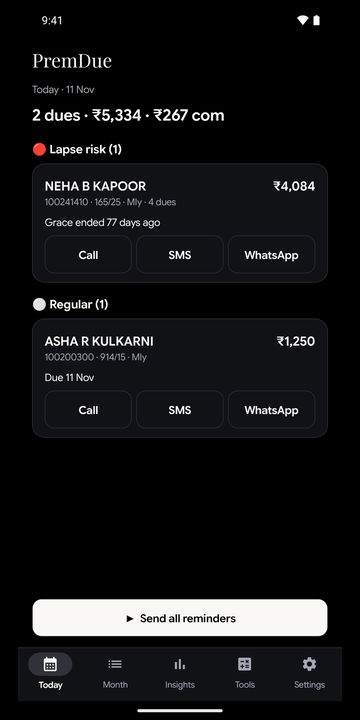
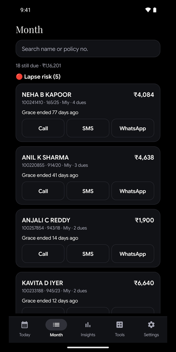
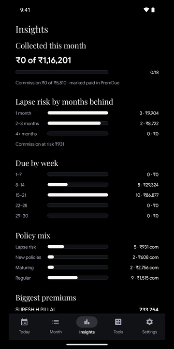
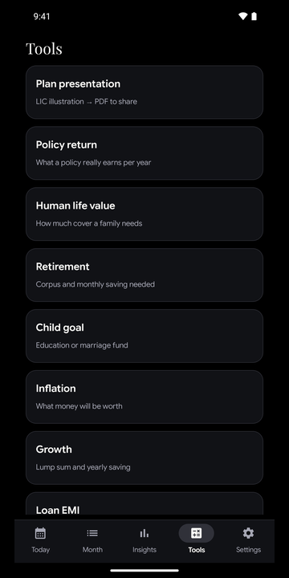
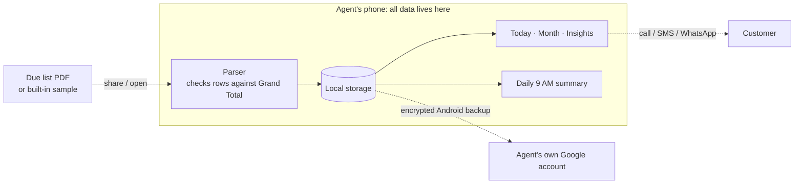
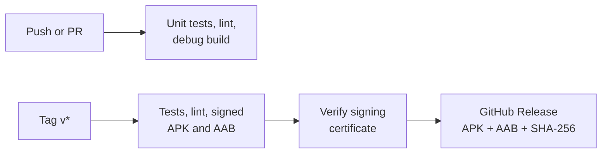

<div align="center">

# PremDue

### The renewal desk for LIC agents, in their pocket.

**Turn the monthly premium due list PDF into a prioritised daily worklist, and stop policies from lapsing.**

[](https://github.com/aryanipb/premdue/actions/workflows/ci.yml)
[](https://github.com/aryanipb/premdue/actions/workflows/release.yml)
[](https://github.com/aryanipb/premdue/releases/latest)


</div>

---

<p align="center">
  
  
  
  
</p>
<p align="center"><sub>Screens from the built-in sample list. All names and policies are fictional.</sub></p>

## The problem

An LIC agent's income depends on renewals, and renewals depend on chasing people. Every month the agent gets a due list as a PDF: a dense table of policy numbers, names, plans and premium modes. It says what is due, but not who to call first, whose grace period is running out, or which policy is about to lapse. Every missed follow-up can cost the customer their cover and the agent their commission.

## The solution

PremDue reads that PDF and turns it into a worklist. The agent shares the file to the app and immediately sees who needs attention today, then reaches each customer in one tap.

| | |
|---|---|
| 📄 **Instant PDF import** | Parses the official due list on the device, and checks the rows against the printed grand totals so a bad parse is refused, not silently wrong. |
| 🔴 **Lapse-risk triage** | Groups policies into lapse risk, new, maturing and regular, using LIC grace rules: 15 days for monthly premiums, 30 for the rest. |
| 💬 **One-tap follow-up** | Call, SMS or WhatsApp with the number and message filled in, then record the outcome on return. |
| 🔔 **Daily 9 AM summary** | A notification with the day's work, which recovers after a reboot or clock change. |
| 📊 **Insights** | Collections this month, lapse risk by months behind, dues by week, policy mix, biggest premiums and month-to-month trends. |
| 🧮 **Sales tools** | Policy return (IRR), human life value, retirement, child goal, inflation, growth, loan EMI and loan + SIP planners. |
| 🖨️ **Plan presentations** | Turn a plan illustration into a branded PDF and share it with a customer. |
| 🧪 **Try it instantly** | A built-in sample due list with fictional customers shows the whole flow without a real PDF. |
| 🔒 **Private by design** | No account, no ads, no analytics, no internet permission. Customer data stays on the phone. |

## Business model

**Free for now**, with no account and no ads, while PremDue builds its base of agents. The earlier paid build (v1.0.0, ₹299 one-time through Razorpay) is preserved in the git history for when paid features return.

## Architecture

The core decision: **there is no server.** Everything happens on the agent's phone, so customer data cannot leak from a backend that does not exist.



### Engineering highlights

- **Small on purpose.** About 2,600 lines of Kotlin with no UI framework dependency, and only two runtime libraries.
- **Verified parsing.** Row totals must reconcile with the document's own grand totals before a list is accepted.
- **Self-checking sample.** The sample list is drawn as a real PDF on the phone and read back through the same parser as a real list, and unit tests check that it reconciles.
- **Modern Android.** Targets Android 16 (API 36) and draws edge-to-edge, with system-bar and keyboard insets handled by hand.
- **Privacy built in.** Data minimisation is designed around India's DPDP Act, 2023: see the [privacy policy](web/privacy.html).

## CI/CD



Every release is built by GitHub Actions from a tagged commit. The pipeline stops if the tag does not match the app version, or if the APK is not signed with the production certificate.

## Install

Download the latest APK from [**Releases**](https://github.com/aryanipb/premdue/releases/latest). It requires Android 8.0 or newer, and Android will ask you to allow installs from your browser. A Google Play release is in closed testing.

## Build from source

Requires JDK 17 and the Android SDK (API 35).

```bash
./gradlew testDebugUnitTest lintDebug assembleDebug
```

A fresh clone builds a debug APK without signing keys.

## Project layout

```text
app/      Android app (Kotlin): parsing, worklist, calculators, PDF generation, sample list
web/      Landing and privacy pages
.github/  CI and release pipelines
```

## Tech stack

Kotlin · Android SDK (API 36) · PDFBox Android · JUnit · GitHub Actions

---

<sub>PremDue is an independent product and is not affiliated with, endorsed by or sponsored by Life Insurance Corporation of India. See [LICENSE](LICENSE).</sub>
